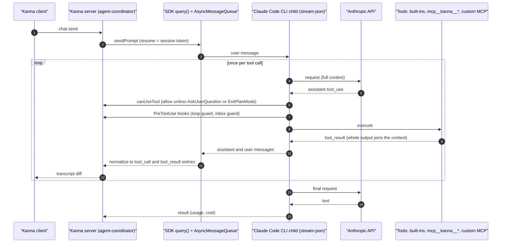
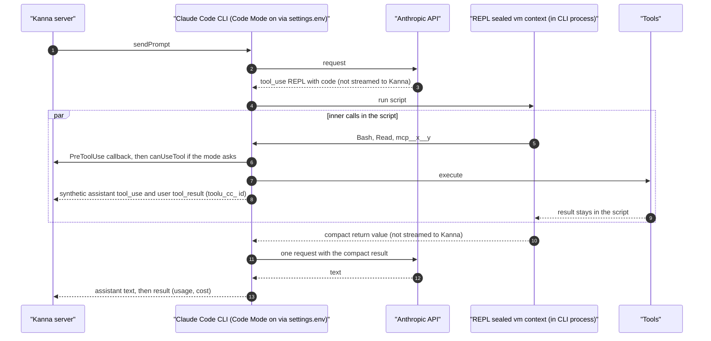
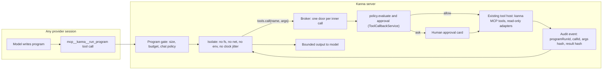

# Code Mode and programmatic tool execution for Kanna: research and recommendation

Date: 2026-11-28. Status: research plus a measured spike outside Kanna; no Kanna implementation yet.
The owner's decisions on the open questions are recorded in section 10, and the measured results in
section 3.2. Base revision: `origin/main` at
`49141fb3` (Agent SDK `0.3.330`, bundled Claude Code CLI `2.1.330`). The local `main` checkout was 99
commits behind at `6b8fd9d2`; every Kanna citation below was re-read on `49141fb3`.

Evidence labels used throughout:

- **[DOC]**: stated in a primary Anthropic or Cloudflare document, fetched 2026-11-28.
- **[CHANGELOG]**: stated in `anthropics/claude-code` `CHANGELOG.md` (top entry 2.1.332).
- **[RE]**: reverse-engineered from the strings of the Claude Code 2.1.332 native binary shipped in
  `@anthropic-ai/claude-agent-sdk-linux-x64@0.3.332`. Undocumented, may change in any release.
- **[PROBE]**: observed in a local run of that binary through the Agent SDK in a scratch directory.
- **[CODE]**: read in Kanna source at `49141fb3`.
- **[ASSUMPTION]**: not verified; stated so it can be tested.

## 1. Executive summary

1. **Native Code Mode is technically reachable from Kanna's transport, but only through an
   undocumented path.** The public Code Mode page says the surface must be "an interactive `claude`
   session in a terminal" [DOC]. The changelog for 2.1.332 fixes bugs in "Code Mode sessions in the
   Agent SDK and `claude -p`" [CHANGELOG], and the 2.1.332 binary's own refusal text says
   "claude -p and Agent SDK apps get it only when CLAUDE_CODE_EXPERIMENTAL_CODE_MODE is in the env block of
   --settings (the SDK's settings option)" [RE]. With a Kanna pool token and the SDK `settings` option,
   Code Mode ran end to end on CLI 2.1.332 [PROBE]. The documentation and the binary disagree, so the SDK
   path is not a supported contract today; the owner accepted that risk (section 10).
2. **Kanna's controls survive Code Mode in the probe.** Every inner call reached the SDK `PreToolUse`
   callback hook under its usual name (2,289 of 2,289 `toolu_cc_` inner calls across 20 Code Mode runs), a hook deny inside a
   script held (canary test), and an inner call that needed permission reached `canUseTool` with a
   `toolu_cc_` id [PROBE]. The script runs in a sealed `vm` context with no `require`, `import`,
   `process`, `fetch` or `Bun`, so its only reach is through tools [PROBE]. Kanna's own policy is
   unchanged: `canUseTool` allows everything except `AskUserQuestion` and `ExitPlanMode`
   (`src/server/claude-spawn-helpers.ts:72-101`) [CODE], which the owner confirmed as intended ("yolo").
3. **Measured (Opus 5.5, 5 runs per arm; Haiku 5.5, 3 runs).** On a fan-out task (40 files, 13 broken
   links) Code Mode cut model turns from 5 to 3 (p50), total input tokens by 39 % (93k to 57k, 95 % CI of
   the difference excludes zero) and API time by 39 %, with equal correctness (all runs exact). Cost at
   list price did not improve measurably (p50 USD 0.060 vs 0.080, CI spans zero) because cache writes
   dominate small runs. On a single-search task (one grep) turns were unchanged, and the only saving was
   a 23 % smaller fixed prefix. Code Mode also streams 200 to 390 inner tool rows per fan-out turn where the
   baseline streams 4 to 10, which Kanna would render as rows. Anthropic's 98.7 % example is not
   reproduced and is not a Kanna expectation.
4. **Recommendation, after the owner's decisions.**
   - **Option A (native opt-in passthrough): GO to an implementation plan**, default-on for eligible
     chats as the owner asked, behind a server kill switch, with the work items in section 9 (stickiness,
     eligibility, grouped rendering of inner calls, a visible resume failure).
   - **Status quo** stays the behaviour for ineligible chats (Codex, Antigravity, OpenRouter, custom
     endpoints, models older than 5.5).
   - **Option B (Kanna-built sandboxed program runner): NO-GO.** Native Code Mode already gives Claude
     chats the measured benefit with Kanna's hooks intact; B would rebuild it with a new security
     perimeter. Revisit only for Codex or Antigravity on measured need.
   - **Option C (hybrid): NO-GO**, for the same reason.

## 2. Verified external facts

### 2.1 Claude Code Code Mode

| Question | Finding | Label |
| --- | --- | --- |
| What it is | Claude writes JavaScript that calls tools; Claude Code runs it in the session. Experimental, off by default, "may change or be removed in any release". | DOC |
| Enabling | `CLAUDE_CODE_EXPERIMENTAL_CODE_MODE=1` in the shell or `~/.claude/settings.json`. A project's settings files cannot turn it on. A `0` anywhere wins; managed settings can force `0`. | DOC |
| Headless enabling | In `claude -p` and Agent SDK apps the variable is honoured only from the flag-settings layer (`--settings`, the SDK `settings` option); the shell environment is ignored there. | RE, PROBE |
| First release | Added in 2.1.323. Cloud providers need 2.1.331. Agent teams 2.1.326, mods 2.1.327, OpenTelemetry events 2.1.329. | DOC, CHANGELOG |
| Tool | `REPL`, "Available only when Code Mode is on". A `PreToolUse` hook reads the script from `tool_input.code`. `PostToolUse` `tool_response` carries `code`, `result`, `stdout`, `stderr`, `toolsUsed`, optional `error`, `images`, `documents`, `uncutOutputNote`. No other public schema; the SDK typings (`sdk.d.ts`, `sdk-tools.d.ts` in 0.3.332) have no `REPL` input type. | DOC |
| Script API | `$` shell tagged template (`.text()`, `.nothrow()`), `edit()`, `write()`, `log`, `preview`, `sleep`, a `tools` accessor, tool search for MCP tools. Partly documented by example only. | DOC, CHANGELOG |
| Models | Opus 5.5, Sonnet 5.5, Haiku 5.5, Fable 5.2 (gate: major 5, minor >= 5, or Fable/Mythos >= 5.2). | DOC, RE |
| Accounts | Claude subscription, Console account, cloud providers (2.1.331+). Not through a gateway, an API key helper, `ANTHROPIC_AUTH_TOKEN`, custom auth headers, HIPAA or ZDR. In headless mode, first-party Anthropic API only. | DOC, RE |
| Surfaces | Docs: interactive terminal only; not VS Code, Desktop, cloud sessions. Binary: "the terminal, with claude -p, and in Agent SDK apps, and not in cloud, remote, or prewarmed sessions". | DOC vs RE |
| Other refusals | `--restricted`, a `--tools` list without `REPL`, `REPL` in `disallowedTools` or a deny rule; `CLAUDE_AGENT_SDK_MCP_NO_PREFIX` set; background jobs, teammates' split panes, Remote Control; OpenTelemetry tracing on. | DOC, RE, PROBE |
| Resume | A Code Mode session resumes only with Code Mode on; a session started without it resumes without it. On resume, earlier script variables are gone. | DOC, CHANGELOG |
| Fork | `/fork` cannot start a background copy. Behaviour of SDK `forkSession` is not documented. | DOC; SDK fork is ASSUMPTION |
| Permissions | Rules and `PreToolUse` hooks apply to inner calls under the tool's usual name. In auto mode the classifier reviews the code, not each call, and cannot see run-time values. In the asking modes the user is prompted per inner call. A Bash hook can receive `cd 'app' && git push`. | DOC |
| Hook failure | A `PreToolUse` hook that errors no longer refuses the inner call unless `onFailure: "block"` (2.1.329). | DOC, CHANGELOG |
| Output redaction | Use `PostToolUse` on `REPL` with `updatedToolOutput`; `refusedCalls` can repeat refused input unredacted. | DOC |
| Sandbox | The shell sandbox applies to commands the script runs. The JavaScript itself and its file, web and MCP calls run outside the sandbox. | DOC |
| Time limits | Foreground script stops after 10 minutes; background scripts up to 2 hours in auto or bypass modes. Time at a permission prompt does not count in manual and acceptEdits modes (2.1.328+). | DOC |
| Cancellation | Esc stops the script; finished calls stay applied. Background shell commands, subagents and MCP calls the script started can keep running and must be stopped from `/tasks`. | DOC |
| Subagents | A subagent with a `tools` list needs `REPL` in it to use Code Mode. | DOC |
| Telemetry | Inner calls emit OpenTelemetry `tool_decision` and `tool_result` under the usual tool name, with `tool_use_id` prefixed `repl_` or `toolu_cc_`. | DOC |
| Maturity | 2.1.323 to 2.1.332 contain 79 changelog entries about Code Mode (49 of them fixes), including lost replies on SDK resume, silently skipped tool calls, runaway memory and stalled subagents. | CHANGELOG |

### 2.2 Anthropic "Code execution with MCP" (engineering article)

The article proposes presenting MCP servers as a file tree of typed functions that the agent reads on
demand, with control flow, filtering and privacy-preserving data flow (PII tokenized in the harness)
running in code [DOC]. The 98.7 % saving (150,000 to 2,000 tokens) follows a single Google Drive to
Salesforce example and is not itemized [DOC]. The article warns that running agent code "requires a
secure execution environment" with sandboxing, resource limits and monitoring [DOC].

### 2.3 Anthropic Programmatic Tool Calling (Messages API)

PTC is a Messages API feature: a `code_execution_20260120` (or later) server tool plus
`allowed_callers: ["code_execution_20260120"]` on client tools [DOC]. Claude's Python in an
Anthropic-managed container calls those tools; each call reaches the client as a `tool_use` with a
`caller` field, and its result does not enter the model's context [DOC]. Constraints: MCP connector
tools cannot be called programmatically, `allowed_callers` "is not a hard API-level block" and must
not be used as a security boundary, a pending call times out after about 4 minutes, results must be
text, not ZDR-eligible [DOC]. Measured by Anthropic: about 38 % fewer billed input tokens on a 75-tool
benchmark with no accuracy change; unchanged score and about 8 % more cost on tau-squared-bench; 20 to
40 % typical savings for requests with 10 to 49 tools [DOC].

**Relevance to Kanna:** low. Kanna does not own a Messages API loop for Claude chats; it drives the
CLI through the Agent SDK. PTC would matter only for a Kanna-owned loop, which does not exist.

### 2.4 Cloudflare Code Mode

MCP tools become a generated TypeScript API; code runs in a fresh V8 isolate per snippet created by the
Worker Loader API; `fetch()` and `connect()` throw; MCP access is through RPC bindings that the
supervisor authorizes, so "the AI cannot possibly write code that leaks any keys" [DOC]. No
quantitative results are reported [DOC]. This is the reference design for an isolation-first Option B.

## 3. Compatibility probe (what was actually run)

Setup: SDK `0.3.332` installed into `/tmp/cm-sdk-pkg` with `--ignore-scripts`; scripts in a separate
`/tmp/cm-probe-scripts`; working directory `/tmp/cm-probe-work` holding 40 synthetic Markdown files with 13
known broken links. `settingSources: []` so the user's hooks and settings were not loaded; all
`CLAUDE*`, `CLAUDECODE` and `ANTHROPIC*` variables stripped from the child env. No global file was
changed; the headless opt-in path writes no consent key to `~/.claude.json` [RE: the
`codeModeCaveatsAcceptedV1` write sits only in the interactive confirmation path]. The probe's session
transcripts were deleted afterwards.

| Variant | `REPL` in init tools | Code Mode notice |
| --- | --- | --- |
| `settings.env` = 1, `claude-haiku-5-5` | no | "isn't available: Claude Code couldn't read your organization's settings or policy" |
| `settings.env` = 1, `claude-opus-5-5` | no | same (passed the entrypoint and model gates, stopped at policy read) |
| `settings.env` = 1, `claude-sonnet-4-6` | no | "for now it only works with Opus 5.5, Sonnet 5.5 and later models" |
| `settings.env` = 1 plus `CLAUDE_AGENT_SDK_MCP_NO_PREFIX=1` | no | "CLAUDE_AGENT_SDK_MCP_NO_PREFIX is set, so the app's own tools could take the names of the functions that scripts use" |
| process env only (`env` option) = 1 | no | none: silently off |
| `settings.env` = 1, `tools: [Read, Glob, Grep]` | no | policy-read notice (the expected `tools` refusal was masked; inconclusive) |
| `settings.env` = 0 | no | none |

These first runs used the standalone `~/.claude` login, which had expired, so each failed with
`Failed to authenticate: OAuth session expired and could not be refreshed` before any model request.

### 3.1 Authenticated gate runs (owner approved using Kanna's token pool)

The probe then loaded the one active first-party OAuth token from Kanna's pool
(`~/.kanna/data/settings.json`, `claudeAuth.tokens`) in-process into `CLAUDE_CODE_OAUTH_TOKEN`, exactly
as `buildClaudeEnv` does; the token was never printed or written. Permission mode `acceptEdits` and an
allow-by-default `canUseTool` mirror Kanna. A `PreToolUse` callback hook logged every call and denied
any call whose input mentioned `canary`.

| Gate | Result | Label |
| --- | --- | --- |
| G1 start | Code Mode ran. `REPL` is **not** listed in `system/init` `tools`, and no notice is emitted when it is on; the only sign is that tools are called with `toolu_cc_` ids. | PROBE |
| G1 resume | Resuming the Code Mode session without the setting fails: "Failed to resume session: This session was started in Code Mode (experimental), which is off in this run, so it can't be resumed." With the setting it resumes and hits the prompt cache. | PROBE |
| G2 hooks | The SDK `PreToolUse` callback saw 2,289 of 2,289 inner calls across 20 Code Mode runs, under the tool's usual name (`Bash`, `Read`). | PROBE |
| G2 deny | A hook deny on an inner `Read` of `secret/canary.txt` held; the canary value never reached the reply (2 of 2 runs per arm). | PROBE |
| G2 canUseTool | An inner `git init` that acceptEdits does not auto-allow reached `canUseTool` with a `toolu_cc_` id; writes inside the working directory were auto-allowed, as for direct calls. | PROBE |
| G3 stream | Each inner call arrives as a synthetic `assistant` message with one `tool_use` block (id `toolu_cc_…`, `parent_tool_use_id` null) followed by a `user` `tool_result`, in the same shape as a direct call. The `REPL` call itself, its code and its return value **never** appear on the SDK stream, and the SDK callback hooks never see `REPL`. The code is recorded only in the CLI's own session file under `~/.claude/projects/`. | PROBE |
| Ambient authority | A script that tried `require('fs')`, `import('node:fs')`, `Bun.file`, `process.env`, `fetch` and `child_process` got: "Module loading (require) is not available in REPL — the vm context is sealed", "Bun is not defined", "process is not defined", "fetch is not defined". | PROBE |

### 3.2 Benchmark results

Arms: baseline vs Code Mode, same pinned binary (CLI 2.1.332), model, prompt, tools, permission mode and
data. Order alternated per repetition. Runs are back to back within minutes, so after the first run of
each arm they are warm-cache runs; no separate cold series was run (a cold run needs a gap of more than
an hour). Raw rows: `/tmp/cm-probe-scripts/runs/*.json`. 35 runs in total, USD 1.92 at list price on the
owner's subscription.

**Fan-out task, Opus 5.5** (40 files, 13 broken links; n = 5 per arm; both arms 5/5 exact):

| Metric | Baseline p50 | Baseline p95 | Code Mode p50 | Code Mode p95 | Change of p50 | 95 % CI of the difference |
| --- | --- | --- | --- | --- | --- | --- |
| Model turns | 5 | 11 | 3 | 4 | -40 % | -8 to -1 |
| Tool calls (rows Kanna would render) | 4 | 10 | 216 | 388 | +5,300 % | -1 to 384 |
| Total input tokens (fresh + cache read + cache write) | 93,221 | 219,474 | 57,274 | 72,259 | -39 % | -162,200 to -20,962 |
| Cache-read tokens | 91,041 | 210,514 | 55,124 | 60,291 | -39 % | -155,390 to -30,750 |
| Cache-write tokens | 2,170 | 8,938 | 6,789 | 16,485 | +213 % | -4,803 to 14,315 |
| Output tokens | 1,226 | 2,383 | 965 | 1,121 | -21 % | -1,418 to -105 |
| Cost, USD list | 0.060 | 0.161 | 0.080 | 0.161 | +34 % | -0.082 to 0.101 |
| Wall time, ms | 24,208 | 40,168 | 21,425 | 23,796 | -11 % | -18,743 to 1,614 |
| API time, ms | 23,505 | 39,385 | 14,249 | 16,181 | -39 % | -25,136 to -4,517 |

**Fan-out task, Haiku 5.5** (n = 3 per arm; both 3/3 exact): turns 6 to 3, total input 117,448 to 43,384
(-63 %, CI -107,476 to -12,648), cost USD 0.003 to 0.003, wall time 15.4 s to 16.3 s (no change).

**Single-search task, Opus 5.5** (92 adapter files in a copy of `src/server`, 15 with `process.env`;
n = 5 per arm; both 5/5 exact): both arms used one grep in two turns. Total input 34,905 to 27,050
(-23 %, CI -7,858 to -7,855): the Code Mode request prefix is about 7,850 tokens smaller, a fixed saving
per request. Cost and wall time unchanged.

Reading the numbers:

- Code Mode pays off where work fans out: fewer model round trips, less re-read context, faster API time.
  It changes nothing for a task the baseline already does in one call.
- Cost did not drop in these small runs: cache writes, which cost more than reads, vary run to run and
  dominate at this size. Longer chats, where the re-read prefix grows each round trip (section 4.2),
  are where the cache-read saving should matter; that is not yet measured.
- In 1 of 5 Opus fan-out runs the model made 3 calls rather than looping; Code Mode is a capability the
  model may not use.
- Kanna-side volume grows: a fan-out turn streams 400 to 780 SDK messages instead of 17 to 38, and each
  becomes a transcript entry and a rendered row unless Kanna groups them.
- Small samples, one machine, one account, synthetic tasks, and fewer repetitions than section 7 asks
  for (5 and 3, not 10), no cold series, and three of its five tasks (cross-session research, MCP fan-out,
  sequential control) not yet run. Treat as directional, not as a guarantee.
- The probe used CLI 2.1.332; Kanna pins SDK 0.3.330 (CLI 2.1.330). Re-run the gates on the version
  Kanna ships.

## 4. Kanna today (findings, `49141fb3`)

| Area | Finding | Evidence |
| --- | --- | --- |
| Transport | Claude, OpenRouter and custom endpoints all run SDK `query()` in streaming-input mode with a long-lived `AsyncMessageQueue`; no PTY, no direct `claude -p`. | `src/server/claude-session-start.ts:182-244`; `src/server/provider-catalog.ts:114-116` |
| Binary | SDK-bundled CLI unless `CLAUDE_EXECUTABLE` overrides it. | `claude-session-start.ts:233` |
| Settings layers | `settingSources: ["user", "project", "local"]`; no `settings` option, so Code Mode cannot turn on today even if a user sets the variable in `~/.claude/settings.json` (headless ignores that source). | `claude-session-start.ts:232` [CODE + RE] |
| Tools | Default chats get the `claude_code` preset plus Grep, Glob and Task tools, minus CLI tools Kanna owns. Path-confined chats get an explicit 16-tool list without `REPL`, which would make Code Mode refuse ("tools"). | `src/server/claude-session-config.ts:110-163` |
| Permission mode | `acceptEdits`, or `plan`; toggled in place with `setPermissionMode`. | `claude-session-start.ts:204,315-316` |
| `canUseTool` | Allows everything except `AskUserQuestion` and `ExitPlanMode`, which are parked for the user. | `claude-spawn-helpers.ts:72-101` |
| Hooks | `PreToolUse` callback matchers: the loop guard (denies listed native tools while a loop is armed) and the inbox guard; `PreCompact`/`PostCompact` observers. | `claude-session-start.ts:54-116` |
| Durable approvals | `ToolCallbackService` (HMAC request ids, args hash, toolUseId dedup) is now used only by beacon tools; the `KANNA_MCP_TOOL_CALLBACKS` flag path was removed in #1516. | `src/server/tool-callback.ts:41-80`; `kanna-mcp-beacon.ts:176` |
| Env | `buildClaudeEnv` strips `CLAUDECODE` and `CLAUDE_CODE_OAUTH_TOKEN`, then injects a pool OAuth token or API key, or, for custom endpoints, `ANTHROPIC_BASE_URL` plus `ANTHROPIC_AUTH_TOKEN` (which Code Mode refuses). | `claude-spawn-helpers.ts:133-170` |
| MCP | In-process `mcp__kanna__*` via `createSdkMcpServer`; user MCP servers passed to the SDK with OAuth bearers as headers. | `claude-session-start.ts:212-224`; `claude-session-config.ts` (`buildUserMcpServers`) |
| Rendering | `REPL` would normalize to `unknown_tool` with `payload` = input; MCP tools to `mcp_generic`. No tree built from `parent_tool_use_id` in the normalizer. | `src/shared/tools.ts:258-265`; `claude-message-normalizer.ts` |
| Respawn | A new CLI process (with `--resume`) when endpoint fingerprint, path, effort, fork, extra directories, loop-armed state, pending clear or stale bearers change; model changes are applied in place with `setModel`. | `src/server/claude-session-spawner.ts:129-144,289-293` |
| Resume failure | Only "No conversation found with session ID" triggers the fresh-session retry; any other resume refusal surfaces as a failed turn. | `claude-prompt-helpers.ts:49`; `claude-session-runner.ts:85-107` |
| Cancel | In-band `q.interrupt()` raced against a 5 s grace, then `close()`. | `src/server/claude-cancel-handler.ts`; `src/server/harness-types.ts:25` |
| Providers | `AGENT_PROVIDERS` = `claude`, `codex` (app-server), `antigravity` (ACP, #1504), `openrouter`, `custom`; `isClaudeSdkProvider` sends `claude` and the endpoint providers to the SDK path. No capability table; behaviour branches on predicates. | `src/shared/core-types.ts:13`; `src/server/provider-catalog.ts:114-116` |
| Usage data | Transcript entries keep the raw SDK `result` in `debugRaw` (usage, modelUsage, num_turns, durations); transcripts at `~/.kanna/data/transcripts/<chatId>.jsonl`, turn results also in `~/.kanna/data/turns.jsonl`. | `claude-message-normalizer.ts`; `event-logs.ts` |

### 4.1 Current flow



### 4.2 An unplanned baseline data point

The read-only research subagent behind this report ran in a normal Kanna session (Haiku 5.5, no Code
Mode) and audited the repository: 75 model turns, 7,463,544 cache-read tokens, 193,690 cache-creation
tokens, 66,410 output tokens, 321 s, USD 0.61 list price (from its `result` record in
`~/.kanna/data/turns.jsonl`). This is the multi-file audit shape Code Mode targets, and it shows that in
Kanna's real traffic the cost is dominated by **cache reads of a growing prefix per round trip**, not by
fresh input. A Code Mode benchmark should therefore count round trips and cache-read tokens, not only
`input_tokens`. It is one uncontrolled run, not a comparison.

## 5. Options

### 5.0 Baseline: status quo

Every tool call is one model round trip; intermediate output enters the context; the transcript shows
one row per call. Correct, auditable, provider-portable, and already paid for.

### 5.1 Option A: native Code Mode opt-in passthrough (Claude SDK path only)

Shape: one new per-chat (or per-server, for the spike) decision, "Code Mode", owned by the Claude
session start. When on, `startClaudeSession` passes
`settings: { env: { CLAUDE_CODE_EXPERIMENTAL_CODE_MODE: "1" } }` and the chat's choice joins the respawn
fingerprint so it is fixed for the session's lifetime. Everything else is existing machinery.



Every step on the Kanna side of this diagram was observed in section 3.1 [PROBE]. Kanna never sees
the `REPL` call: not on the stream and not in its callback hooks.

Required decisions and constraints:

- **Eligibility** is computed once, from facts Kanna already has: provider `claude` (not `openrouter` or
  `custom`, which set `ANTHROPIC_BASE_URL` and `ANTHROPIC_AUTH_TOKEN`), a 5.5-or-later model, and a
  `claude_code` tool preset. Path-confined chats send an explicit tool list; adding `REPL` to it would
  let them in (the sealed context reaches files only through tools, which the path policy already
  governs), which is the owner's "as many chats as possible" choice but needs its own test. Ineligible
  chats never pass the setting, so the CLI never prints a refusal mid-chat.
- **Permission mode:** the owner chose "yolo". Code Mode scripts run in the background (up to two hours,
  without blocking the chat) only in `auto` or `bypassPermissions`; in Kanna's `acceptEdits` they block
  for up to ten minutes [DOC]. Moving Claude chats to `bypassPermissions` is a separate, visible change
  and must keep the loop and inbox `PreToolUse` guards. The Code Mode page names `deny`/`ask` rules and
  `PreToolUse` hooks as the controls that still apply in auto and `bypassPermissions` [DOC]; the probe
  measured hooks only under `acceptEdits`, so a bypass-mode run of the canary test is a gate (G4).
- **Stickiness:** a session started in Code Mode must always resume in Code Mode, and one started without
  it must stay without it [DOC]. The flag is therefore a property of the Claude session token, not of the
  chat's current preference. Switching mid-chat means `/clear` (new session), never an in-place toggle.
- **Model switches:** `setModel` is applied in place (`claude-session-spawner.ts:289`). Switching a Code
  Mode session to an unsupported model has unspecified behaviour [RE shows a "waitsForModel" re-check];
  Kanna should restrict the model picker for Code Mode sessions to eligible models.
- **Token pool rotation:** the binary has a `credential_changed` reason that restarts without Code Mode
  when the signed-in principal changes [RE]. If Kanna's pool hands a respawned session a token for a
  different account, the resume may be refused. Pin the pool token per Code Mode session, or test it.
- **Loop guard and inbox guard** are `PreToolUse` callback matchers, which saw every inner call in the
  probe (G2). Keep a public-seam test that a guarded tool called from a script is denied, so a CLI update
  that changes this fails CI rather than a user.
- **Rendering and volume:** inner calls already arrive as ordinary `tool_call`/`tool_result` pairs, so the
  existing normalizer records and audits each one with no change. The problem is volume: 200 to 390 rows
  for one fan-out turn. Group consecutive `toolu_cc_` calls of one assistant step into one collapsed
  "script ran N tool calls" row (counts by tool, failures, expand to the rows). The `REPL` code and return
  value are not on the stream; showing them would mean reading the CLI's session file, which is out of
  scope for a first version. Measure transcript bytes and snapshot size with grouped rows (CLAUDE.md
  snapshot-size rule).
- **Hooks in user settings:** `settingSources` includes `user`, so a user's own `PreToolUse` hooks apply
  too; Code Mode changes their failure semantics (`onFailure`) [DOC].

Cost: small code surface (one option, one fingerprint field, one eligibility predicate, one tool kind),
but a high maintenance risk: experimental, undocumented for the SDK, changing every release, and a
one-way session property.

### 5.2 Option B: Kanna-built sandboxed program runner (provider-independent)

Shape: one new Kanna MCP tool (for example `mcp__kanna__run_program`) available to every provider that
can call Kanna's MCP server (Claude, Codex, Antigravity). The program runs in an isolate with no ambient
authority; its only capability is a `tools.call(name, args)` broker that sends each inner call through
Kanna's existing policy and approval door and records an audit event.



What it needs that Kanna does not have:

- An isolation runtime. Bun has no built-in V8 isolate API with hard memory limits; candidates are a
  QuickJS-in-WASM interpreter, `isolated-vm` (native addon, Node-oriented), or a child process with OS
  sandboxing. Each is a new dependency with its own escape history.
- A broker that can reach the tools the model actually uses. The native CLI tools (Bash, Read, Edit)
  live inside the CLI process, not in Kanna; Option B could only call Kanna's own MCP tools and adapters
  Kanna implements again, which re-opens the shim layer #1516 deleted.
- Program-level budgets, partial-failure reporting, replay semantics and a nested UI, all new.

Benefit: provider-independent, Kanna owns the audit and approval per inner call, and the isolation can
be stronger than Claude Code's (which runs JavaScript and its file, web and MCP calls outside the shell
sandbox [DOC]).

Cost: a new deep subsystem with its own security perimeter, built to save tokens nobody has measured in
Kanna yet. It also competes with the model vendors' native features (Claude Code Code Mode, PTC), which
will keep improving.

### 5.3 Option C: hybrid

Native Code Mode where eligible, Option B elsewhere. It carries both implementations, two audit
vocabularies to reconcile and two failure surfaces, for a benefit that exists only if B is justified on
its own. Not recommended until then.

### 5.4 Comparison

| Criterion | Status quo | A: native passthrough | B: Kanna runner | C: hybrid |
| --- | --- | --- | --- | --- |
| Implementation size | none | small (option, fingerprint, eligibility, tool kind) | large (runtime, broker, budgets, UI, audit) | large plus small |
| Maintenance | none | high churn: experimental, undocumented SDK path | high: owned security perimeter | highest |
| Provider lock-in | none | Claude first-party only, 5.5+ models | none | mixed |
| Reaches native tools (Bash, Read, Edit) | yes | yes | no, Kanna MCP tools only | partly |
| Per-inner-call approval | none for Claude today | same as today: hooks and `canUseTool` fire per inner call [PROBE] | yes, Kanna owned | mixed |
| Audit per inner call | full, one row per call | full: every inner call streams as a normal row [PROBE]; the script itself is not visible | full, Kanna owned | mixed |
| Isolation of model-written code | n/a | sealed `vm` context, no require/process/fetch [PROBE]; tool calls unsandboxed, as direct calls are | designed in | mixed |
| Resume and fork | proven | resume verified, one-way; fork unverified | Kanna owned | both |
| Measured token and latency win | baseline | fan-out: -39 % input tokens, -40 % turns, -39 % API time, cost flat; single call: -23 % fixed prefix only [PROBE] | unmeasured, plus Kanna overhead | unmeasured |
| UX | familiar row per call | many more rows (200 to 390 per fan-out turn) unless grouped; code not visible | new nested program card | two shapes |

## 6. Threat model and invariants

Assets: the user's repository and machine, credentials (pool tokens, MCP bearers, vault-brokered keys),
external accounts reached through MCP (GitHub, Slack, inbox channels), and the integrity of the audit
trail.

Adversaries: prompt injection in tool output (web pages, issues, MCP results, inbox messages); a
model that writes wrong or over-broad code; a malicious or compromised MCP server.

New risks that programs add:

| Threat | Why programs change it | Invariant | Control (A) | Control (B) |
| --- | --- | --- | --- | --- |
| Approval bypass | Many calls per approval, or calls hidden inside one script | Every side-effecting inner call meets the same gate as a direct call, under its own name | G2 passed: hooks saw 100 % of inner calls, a deny held, `canUseTool` fired [PROBE]; keep it as a CI test | Broker is the only capability; no batch approvals |
| Privilege escalation through JS | JS reaches fs, net, env directly | Program code has no ambient authority beyond its tools | Observed: the script context is sealed (no require, import, process, fetch, Bun) [PROBE]; its tool calls run with the same rights as direct calls. A Node `vm` context is not a hardened security boundary; the owner accepted running without a container (section 10) | Isolate with no fs, net, env |
| Secret exfiltration | Code can read a token and pass it to another call; telemetry can log it [DOC] | Credentials never enter model-visible or program-visible data | Keep `OTEL_LOG_TOOL_DETAILS` unset; `PostToolUse` redaction; secrets stay vault-injected | Bindings hold credentials, as in Cloudflare's design |
| Destructive actions without human sight | A script can delete after a run-time-computed search | No hidden destructive action | The owner chose yolo, so no per-call approval, as for direct calls today; each inner call still lands as a transcript row (G3 observed), so grouping must keep failures and writes visible when collapsed | Destructive tools require per-call approval |
| Runaway cost and resources | Loops, fan-out, large outputs | Bounded time, memory, call count, concurrency and output bytes | CLI limits: 10 min foreground, memory stop, output cut with a path to the full text [DOC, CHANGELOG] | Explicit budgets per run |
| Partial failure | Script dies after some side effects | Side effects that finished are reported, never silently retried | Finished calls stay applied after Esc [DOC]; the model must be told | Per-call journal; non-idempotent calls never auto-retried |
| Replay and resume | Restarted turn reruns side effects | Resume never re-executes a finished side effect | CLI resume drops script variables and tells the model [CHANGELOG] | Journal keyed by (programRunId, callIndex, argsHash), the ToolCallbackService dedup pattern |
| Untrusted output steering code | Injected text changes run-time branches the classifier never saw [DOC] | Tool output is data, never code | Rules and hooks on calls, not on code | Program cannot `eval` tool output |
| Audit loss | One REPL row hides N calls | Every inner call has an event with correlation id and provenance | Inner calls keep their own `toolu_cc_` id; the script that made them has no id on the stream, so calls are attributed to the assistant step, not to a program run | Built in |

Non-negotiable invariants for any rollout: no hidden destructive action; no auto-approval introduced by
Code Mode beyond what the chat already allows; every inner call attributable to its program run and
chat; cancel stops the program and reports what already ran; a turn that cannot resume in its original
mode fails visibly, never silently starts a fresh session.

## 7. Benchmark methodology

Goal: decide with data whether Code Mode reduces context, latency and orchestration cost in Kanna's
workloads without hurting correctness, approval parity or audit parity.

Design:

- **Arms:** baseline (Code Mode off) vs Code Mode (on via `settings.env`). Same pinned SDK and CLI, same
  model (`claude-opus-5-5` primary, `claude-haiku-5-5` secondary), same effort, same system prompt
  (Kanna's preset append), same tool set, same MCP servers, same working tree, `settingSources: []` or a
  fixed settings file, `permissionMode` identical.
- **Caching:** each task runs cold (first run in a fresh session after more than one hour, so the 1-hour
  ephemeral cache is gone) and warm (repeat within five minutes). Report them separately; never average
  cold with warm.
- **Repetitions:** at least 10 runs per arm, task and cache state; alternate arm order to cancel drift.
- **Metrics per run** (from the SDK `result` and the stream): `input_tokens`, `cache_read_input_tokens`,
  `cache_creation_input_tokens`, `output_tokens`, thinking tokens, `num_turns`, count of distinct
  assistant message ids (model round trips), tool calls by name (inner and outer), REPL calls, wall time,
  `duration_api_ms`, cost at list price, permission prompts raised, hook invocations recorded, and errors.
- **Correctness:** each task has a machine-checkable answer (exact set match or a scored rubric); report
  exact-match rate and partial precision/recall.
- **Parity checks:** a scripted `PreToolUse` callback hook and `canUseTool` log every invocation; for
  each inner call seen in OpenTelemetry (`repl_` and `toolu_cc_` ids) or in `toolsUsed`, check that the
  hook and the audit log saw it too. Any inner call the hook did not see fails the arm regardless of
  savings.
- **Statistics:** report p50 and p95 per metric with bootstrap 95 % confidence intervals for the
  difference of medians. A saving counts only if the interval excludes zero and correctness does not drop.

Tasks (all read-only):

1. **Synthetic link audit** (Appendix B dataset): 40 Markdown files, 13 broken local links.
2. **Multi-file repo audit:** "list every `*.adapter.ts` in `src/server` with the exported functions
   that touch `process.env`", answer generated by a script on the same tree.
3. **Cross-session research on authorized data:** a fixture copy of synthetic Kanna transcripts (never
   real user chats without consent): "which chats used tool X more than N times", answer from `jq`.
4. **Read-only MCP fan-out:** a local synthetic MCP server with 30 tools returning deterministic JSON
   (for example 500 issues), task "issues labelled bug, opened in month M, with no linked PR".
5. **Sequential control task:** a chain where each call depends on reasoning about the previous result
   (PTC's weak-fit case), to detect regressions.

Reporting rule: no extrapolation from Anthropic's examples; publish per-task numbers only.

## 8. Risk register

| Id | Risk | Likelihood | Impact | Mitigation |
| --- | --- | --- | --- | --- |
| B1 | SDK callback hooks or `canUseTool` stop firing for inner calls in a later CLI | low (passed on 2.1.332) | high (inbox and loop guards bypassed) | Public-seam test of a guarded tool called from a script; re-run on every SDK bump |
| R2 | Undocumented SDK path changes or is removed | high | medium | Server env var, off by default; pin the SDK; re-run the gates on each SDK bump |
| R3 | Code Mode session cannot resume after the flag, model or credential changes | medium | high (chat stuck) | Flag bound to session token; restrict models; pin pool token; visible failure |
| R4 | Transcript and UI flooding: hundreds of inner rows per turn | certain [PROBE] | medium (UX, snapshot size) | Group `toolu_cc_` rows per assistant step; measure snapshot bytes |
| R5 | Tool calls from scripts run outside the shell sandbox, as direct calls do in Kanna | certain [DOC] | medium | Owner accepted (no container); the guards above stay the boundary |
| R6 | No cost saving on short or single-call turns | measured [PROBE] | low | Expected; the win is round trips and context on fan-out work |
| R7 | Pool token rotation triggers `credential_changed` | medium [RE] | medium | Pin a token per Code Mode session; test |
| R8 | Code Mode bugs (lost replies, stalls) degrade long chats | medium [CHANGELOG] | medium | Dev-only spike; keep the status quo as default |
| R9 | Option B isolation escape | medium | high | Do not build B without a dedicated security review |

## 9. Rollout, rollback and phases (proposal; implementation not yet started)

**Opt-in shape (after the owner's decisions):** Code Mode is on by default for every *new* Claude
session that is eligible (section 5.1), with a server kill switch (an environment variable, name to be
fixed against the wiki env-var list) that turns it off for new sessions. It is never applied to an
existing session, because a session cannot change mode in either direction [DOC, PROBE]. **Rollback:**
set the kill switch; new sessions start without Code Mode; existing Code Mode sessions keep resuming in
Code Mode until `/clear`. A resume that the CLI refuses ("started in Code Mode … can't be resumed")
must surface as a visible failed turn with a `/clear` hint, never a silent fresh session; today only
"No conversation found" triggers the fresh-session retry (`claude-prompt-helpers.ts:49`), which is the
right behaviour to keep.

| Phase | Work | Acceptance gate | Status |
| --- | --- | --- | --- |
| P0 | Source verification, gate probe, harness | This report | done |
| P1 | Authenticated start and resume (pool token) | G1: a script runs end to end; resume with the setting works and without it fails visibly | passed [PROBE] |
| P2 | Parity: callback `PreToolUse` and `canUseTool` logging, hook deny, ambient-authority test | G2: 100 % of inner calls seen by the hook, deny held, `canUseTool` fired. G3: stream shape documented | passed [PROBE] |
| P3 | Benchmark, 2 tasks, 2 models | Saving with confidence intervals, correctness not lower | passed for fan-out; no effect on single-call; cost flat (section 3.2) |
| P4 | Kanna implementation: bump the SDK to 0.3.332 or later (CLI 2.1.332 has SDK resume fixes [CHANGELOG]); pass `settings.env` for eligible new sessions; record the mode with the session token and in the respawn fingerprint; restrict model switches to eligible models; group `toolu_cc_` rows; kill switch | `bun run check`; public-seam tests: an eligible chat starts in Code Mode, an ineligible one does not, a Code Mode session respawns in Code Mode, a guarded tool called from a script is denied; manual golden path; `/c3 change` and an ADR | needs a plan approved by the owner |
| P5 | Yolo permission mode (`bypassPermissions`) for background scripts, if wanted | G4: canary deny and loop/inbox guard tests pass under `bypassPermissions` | needs a decision |
| P6 | Measure in real chats | Kanna's own `turns.jsonl` usage before and after, per chat shape, for two weeks; no stuck resumes | after P4 |

## 10. Decisions

Recorded from the owner on 2026-11-28:

1. **Benchmark login:** yes, use the subscription. The standalone `~/.claude` login had expired, so the
   owner chose Kanna's token pool; the probe loaded the active pool token in-process without printing
   or writing it.
2. **Undocumented Agent SDK path:** acceptable.
3. **Per-call approval for destructive tools before Code Mode:** no; Kanna stays in "yolo" mode.
4. **Which chats get Code Mode:** as many as possible. The remaining exclusions are the ones the CLI
   itself refuses (endpoints with their own base URL or auth token, models older than 5.5, a tool list
   without `REPL`, background or Remote Control sessions) plus whatever fails a gate.
5. **Container or VM:** not needed.

Still open:

6. Whether P5 (`bypassPermissions` for Claude chats) is wanted; it is what lets long scripts run in the
   background, and it changes behaviour for direct calls too.
7. Whether path-confined chats should get `REPL` added to their explicit tool list (section 5.1).
8. Whether Option B is ever wanted for Codex and Antigravity sessions, which would need its own
   measurement first.

## 11. Documentation and code disagreements found

- The public Code Mode page restricts the surface to an interactive terminal; the 2.1.332 changelog and
  binary support `claude -p` and the Agent SDK through the `settings` option.
- The Code Mode requirements say v2.1.323+; Kanna's pinned SDK 0.3.330 ships 2.1.330, while the local
  stale `main` checkout pins 0.3.312 (2.1.312), which has no Code Mode at all.
- Kanna docs: `security-sandboxing.md` and the `kanna-sessions` skill describe a 600 s approval timeout
  that the code does not implement (`tool-callback.ts:49` uses `NEVER_EXPIRES`); the `kanna-providers`
  skill names an older bundled CLI version. Follow-ups, out of scope here.

## Appendix A: Sources

- https://code.claude.com/docs/en/code-mode
- https://code.claude.com/docs/en/tools-reference (REPL row)
- https://code.claude.com/docs/en/env-vars (`CLAUDE_CODE_EXPERIMENTAL_CODE_MODE`)
- https://code.claude.com/docs/en/agent-sdk/typescript (`env` and `settings` options)
- https://github.com/anthropics/claude-code/blob/main/CHANGELOG.md (2.1.323 to 2.1.332)
- https://www.anthropic.com/engineering/code-execution-with-mcp
- https://platform.claude.com/docs/en/agents-and-tools/tool-use/programmatic-tool-calling
- https://blog.cloudflare.com/code-mode/
- npm `@anthropic-ai/claude-agent-sdk@0.3.332` (`claudeCodeVersion` 2.1.332), binary strings [RE]

## Appendix B: Reproducible probe and benchmark harness

Prerequisites: a valid first-party login (`claude auth login` in a terminal), Node 22+, a scratch
directory. Nothing here changes Kanna or global settings.

```bash
mkdir -p /tmp/cm-sdk-pkg /tmp/cm-probe-work/docs /tmp/cm-probe-scripts
cd /tmp/cm-sdk-pkg && echo '{"private":true}' > package.json
npm install --ignore-scripts @anthropic-ai/claude-agent-sdk@0.3.332
```

Dataset generator (run with `bun -e` from `/tmp/cm-probe-work`): 40 files `docs/page-NN.md`, each linking
to four other pages as `../docs/page-MM.md` with `MM = (i*7 + k*3) mod 40`, plus `../docs/missing-i.md`
when `i mod 5 = 0` and `../assets/img-i.png` when `i mod 9 = 0`; 13 broken links in total; ground truth
written to `/tmp/cm-probe-scripts/ground-truth.json` as root-relative `{file, target}` pairs.

Probe (`/tmp/cm-probe-scripts/probe.mjs`), essentials:

```js
import { query } from "/tmp/cm-sdk-pkg/node_modules/@anthropic-ai/claude-agent-sdk/sdk.mjs";
const env = Object.fromEntries(Object.entries(process.env)
  .filter(([k]) => !/^(CLAUDE|CLAUDECODE|ANTHROPIC)/.test(k)));
const options = {
  cwd: "/tmp/cm-probe-work", model, env, settingSources: [], permissionMode: "default",
  canUseTool: async (toolName, input, { toolUseID }) => { /* log; allow read-only tools only */ },
  hooks: { PreToolUse: [{ hooks: [async (i) => { /* log i.tool_name, i.tool_use_id */ return {}; }] }] },
};
if (codeMode) options.settings = { env: { CLAUDE_CODE_EXPERIMENTAL_CODE_MODE: "1" } };
for await (const m of query({ prompt, options })) { /* record init.tools, tool_use, tool_result,
  system notifications (key "code-mode-opt-in"), result.usage, num_turns, durations */ }
```

The full harness used for sections 3.1 and 3.2 (`probe2.mjs`, `driver.sh`, `aggregate.mjs`) is in
`/tmp/cm-probe-scripts/`; it adds the pool-token loader, the `PreToolUse` logger and canary deny, the
`askperm`, `ambient`, `canary` and `adapters` tasks, alternating arm order, and the bootstrap
aggregation.
