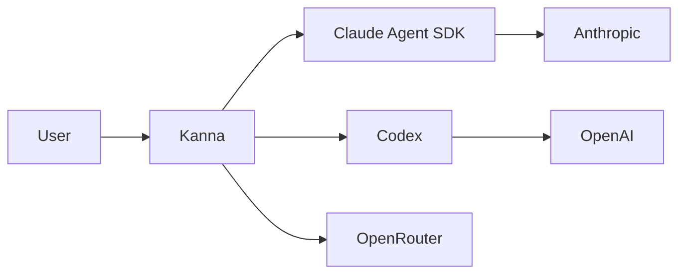

import Screenshot from '../../../components/Screenshot.astro'

## Self-update

One click installs the new version and restarts Kanna on it. Works under pm2, systemd, Docker, or a plain shell via a host-agnostic supervisor, and you can install any prior release straight from the changelog. See [Self-update](/guides/ops/self-update/) for the strategies and overrides.

<Screenshot
  light="/screenshots/light/settings-general.png"
  dark="/screenshots/dark/settings-general.png"
  alt="In-app self-update UI"
/>

## Expose port (Cloudflare tunnel)

The agent can call `mcp__kanna__expose_port` right after it starts a dev server, to surface that localhost port through a Cloudflare quick tunnel. Enable it under **Settings → Cloudflare Tunnel** (off by default) and pick a mode: **Always ask** shows a card in the chat that you accept, **Auto-expose** starts `cloudflared` immediately. After you accept, the card shows **Exposing** until the Cloudflare URL actually answers, then shows the link. Tunnels stop when the chat closes or the server restarts. Requires `cloudflared` on your `PATH`; see [Cloudflare tunnel](/guides/ops/cloudflare-tunnel/).

<Screenshot
  light="/screenshots/light/settings-general.png"
  dark="/screenshots/dark/settings-general.png"
  alt="Expose-port approval dialog"
/>

## Custom MCP servers

Register your own MCP servers from **Settings → MCP servers**. Entries persist in `settings.json` (`customMcpServers`) and are merged in at chat spawn time, so their tools appear as `mcp__<name>__<tool>`.

- **Providers:** every enabled server reaches every provider, in main chats and in subagent runs alike: Claude (including OpenRouter and custom endpoints), Codex and Antigravity. Codex and Antigravity accept only `stdio` and `http` servers; an `sse` or `ws` server reaches Claude only, and Kanna logs a warning naming it when it starts a Codex or Antigravity session. Antigravity ignores a `stdio` server's working directory.
- **No approval step:** Codex and Antigravity run without approvals and without the hooks in `.claude/settings.json`, so an enabled server's tools, including write tools, run unattended there. Disable a server you do not want those providers to use.

- **Transports:** `stdio`, `http`, `sse`, `ws`. The name `kanna` is reserved.
- **OAuth:** `http` and `sse` servers support OAuth 2.1 (PKCE + dynamic client registration + rotating refresh). Kanna has no redirect server, so after the provider redirects to `http://localhost:8765/callback?code=…` you copy that URL from the address bar and paste it back into Settings to complete the flow. Tokens refresh automatically before expiry.
- **Pre-registered OAuth client:** some providers, Slack among them, do not support dynamic client registration. With OAuth enabled, fill in **Client ID** and, if the provider requires it, **Client secret** from an OAuth app you registered with that provider. **Callback port** is optional and defaults to 8765; the redirect URL to register is `http://localhost:<port>/callback`, and the editor shows it for the port you typed. A pre-registered client is used instead of dynamic registration, and editing it takes effect on the next Authenticate or token refresh. The secret is stored in `settings.json` beside the tokens.
- **Example, Slack:** use the URL `https://mcp.slack.com/mcp`. Create or open a Slack app with the MCP feature enabled and add `http://localhost:8765/callback` as a redirect URL. Enable OAuth on the server, enter the app's client ID and secret, click **Authenticate**, approve in Slack, then paste the `http://localhost:8765/callback?code=…` URL from the address bar and click **Complete**.
- **Skills:** a server that publishes Agent Skills (the MCP `io.modelcontextprotocol/skills` extension) has them offered to the model and to the `/` picker. Each row has a **Skills** checkbox next to **On**, on by default; switching it off removes that server's skills at once and leaves its tools alone. Skills need an `http`, `sse` or `stdio` server. See [Local skills & slash commands](#local-skills--slash-commands) for how they appear and what is checked.
- **Connect-test:** creating or updating a server fires a list-tools probe; the row shows a status pill, and a manual **Test** button re-runs it. A server that offers no tools, such as one that only serves skills, passes with zero tools.
- **Trust model:** user MCP tool calls auto-allow — if you installed it, Kanna trusts it.
- **Secrets:** `settings.json` is written with your default file mode, not `0600`. On a shared machine, restrict the directory with `chmod 700 ~/.kanna/data`.

## The LSP tool

Claude chats can call the `LSP` tool for go-to-definition, find-references and go-to-implementation. It is one tool for every language: the Claude CLI picks a language server from whichever `*-lsp` plugin you have installed. Adding a language means installing that plugin **and** putting its server on the `PATH` of the process that runs Kanna, for example `npm i -g typescript-language-server typescript` for `typescript-lsp`, or `go install golang.org/x/tools/gopls@latest` for `gopls-lsp`.

## Workflow status panel

Kanna surfaces Claude Code's native **Workflow** tool (dynamic multi-agent orchestration) in a read-only per-chat panel: every run with live status, drill-in progress, token totals, and an inline transcript card on the launch. It works by watching the `wf_<runId>.json` sidecars Claude writes to disk, so the panel stays accurate without touching the event stream. Stopping or relaunching runs from the panel is out of scope.

## Agent chat re-entry

The agent can hand work off and have the chat pick it up again later, without polling on a timer.

Call `mcp__kanna__delegate_subagent({ run_in_background: true, … })` and the tool returns immediately with a run id while the subagent works. When it finishes, Kanna re-enters the chat as a new turn carrying the result — so a long job costs one wake, not a polling loop. In a chat that is not running a loop the agent keeps its conversation; an armed loop clears the main agent's context on every wake, because the task list is the plan. Delivery is event-driven and provider-agnostic, and it survives a server restart via event replay.

For work that should recur on a **clock** rather than on completion, use [cron jobs](/features/cron-jobs/).

:::note[Removed]
The timer-based `mcp__kanna__schedule_wakeup` tool and its `KANNA_MAX_AGENT_WAKES` cap no longer exist — they were removed when re-entry became notification-driven. A self-polling agent lost momentum across context compaction, which is what the background-delegation path above fixes.
:::

## Local skills & slash commands

The composer's `/` picker lists local Claude Code skills and slash commands discovered on disk alongside Kanna's built-ins, so installed plugin skills are one keystroke away, on every provider including Codex. `/clear`, `/compact` and `/cron` are Kanna's own — see [Slash commands](/features/slash-commands/).

### Skills served by MCP servers

Skills from your MCP servers sit beside local ones. Each is named `<server>:<name>`, using the server name from **Settings → MCP servers**. If two skills on the same server share a name, both use the skill path instead (`acme:billing/refunds`), and if the name matches a local command or skill it becomes `mcp:<server>:<name>`, so an MCP skill never shadows a local one. In the `/` picker an MCP skill shows its server name as the badge. Typing `/acme:refunds order 12` makes the model load that skill with the arguments, on every provider including Claude.

The model sees each skill's name, description, server and URI under **MCP skills** in its instructions (up to 60), and loads one with `read_skill`. Kanna lists skills when it starts, when you change the server settings and again when a server's cache time (between one and ten minutes, five by default) runs out. A slow server never delays a chat: Kanna waits up to three seconds for a refresh and then uses what it has. Nothing is saved to disk.

- **Verified:** every file is checked against the server's manifest for its size, its sha256 digest and, for `SKILL.md`, its frontmatter. A mismatch is refused and the skill is not loaded. A skill over 512 files or 16 MiB is declined.
- **Supporting files:** `read_resource` reads only a file in the manifest of a skill already loaded with `read_skill`, on the same server; asking first is refused with "load the skill first". Text over 256 KiB is cut off with a note, and a binary file is reported only by its type and size.
- **Dynamic skills:** a server may publish a skill as `dynamic`, with no file list to check. Kanna loads it but labels it unverified, and only reads files under its folder.
- **Trust:** the content comes from the server, not from you. It arrives under a header naming the server and saying so, and an `allowed-tools` list in it is ignored: Kanna's own permissions apply.

## Text snippets

**Settings → Text snippets** maps a short `shortcut` to a longer `expansion`, expanded as you type in the composer. Useful for the paragraph of standing context you retype into every new chat.

## Global instructions

**Settings → Instructions** appends text to the system prompt of every agent spawn, on every provider. This is the place for house rules that are not repo-specific — repo-specific ones belong in that repo's `CLAUDE.md` or `AGENTS.md`, which the agent already reads.

## Per-turn token cost

Each turn shows its token usage and estimated USD cost in the transcript, computed from the provider's model pricing — so you can see what a session is spending as it runs.

## Mermaid rendering, checked before you see it

Mermaid diagrams in agent output render inline in the transcript.

Because a syntax error would reach you as a broken diagram, the agent validates
its diagrams against mermaid's real parser (`mcp__kanna__validate_mermaid`)
before answering, and fixes them in the same turn — so you never see the bad
version. If one slips through anyway, an end-of-turn check asks the agent to
correct it, **once** per diagram. Set `KANNA_MERMAID_GUARD=disabled` to turn off
that second pass; the tool itself stays.

## Standalone HTML transcript export

Export any chat to a self-contained HTML file. Inline CSS + screenshots, no external dependencies, sharable.

## Customizable keybindings

See [Reference → Keybindings](/reference/keybindings/) for the full default map and customization syntax.

## Password gate

Protect the HTTP/WS/API surface with a password: run `kanna --password <secret>` and Kanna prompts on every browser session. See [Security](/features/security-sandboxing/#password-gate).

## PWA / mobile layout

Kanna is installable as a PWA. Mobile layout adapts to small viewports with a slide-in sidebar and touch-tuned composer.
